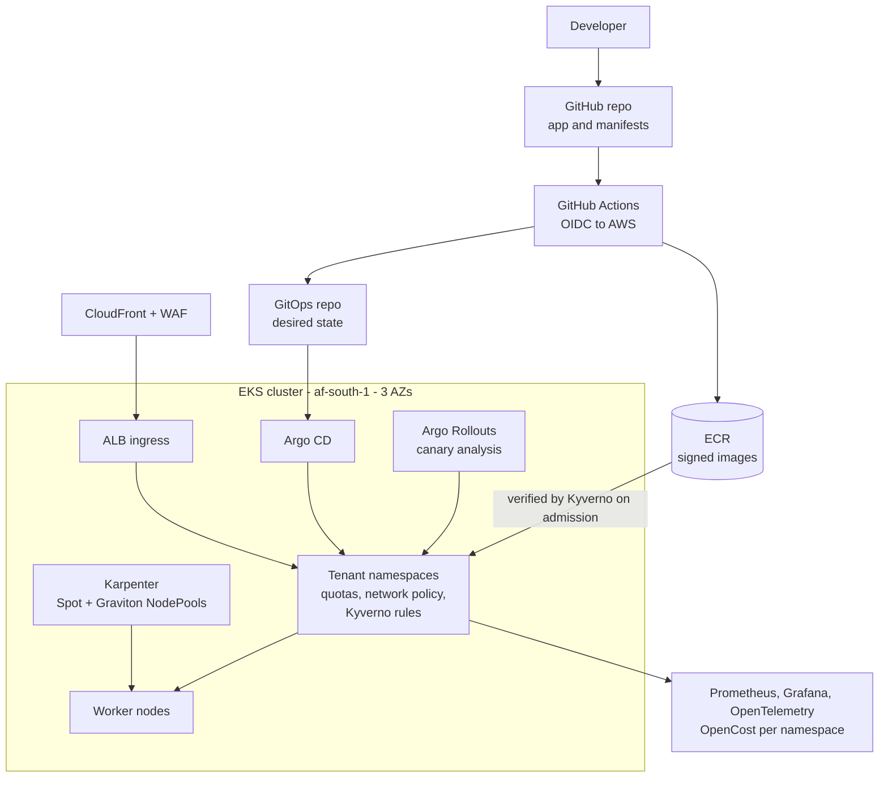
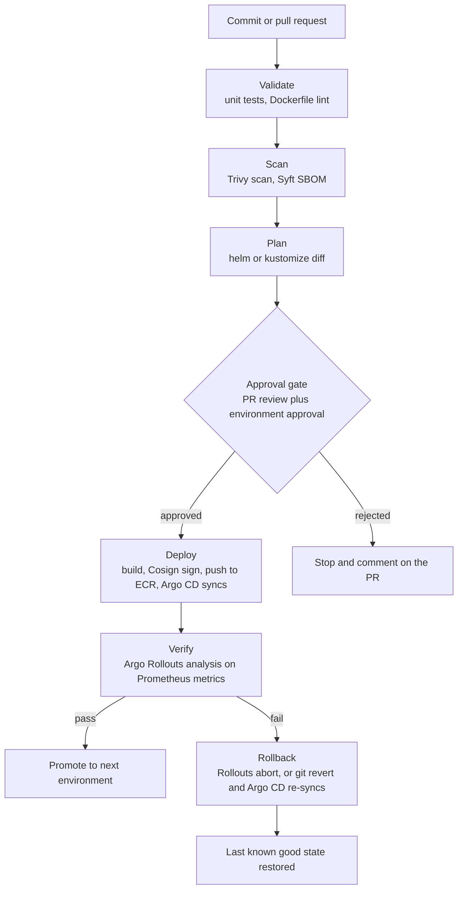
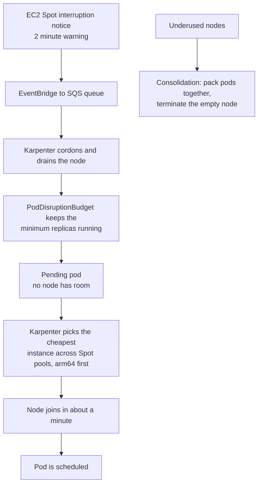

# EKS Golden-Path Platform

A multi-tenant EKS platform where teams ship through GitOps with signed images, Spot-first Graviton nodes managed by Karpenter, and canary releases that abort themselves.

### Business use case

A South African fintech or SaaS company has eight teams, each hand-rolling deploys. A platform team offers one paved road with security, cost and observability defaults built in, so a new service goes live in a day and not a sprint.

### The hard piece

Spot-safe autoscaling plus supply-chain security

### Rough monthly cost, ZAR

R400 to R1,200 a month with teardown. The EKS control plane alone is about R1,300 a month if you leave it running, so create and destroy the cluster as code.

### Tool stack

- EKS (Bottlerocket nodes)
- Karpenter
- Graviton (arm64)
- Spot instances
- Argo CD ApplicationSets
- Argo Rollouts
- Kyverno
- Cosign + Sigstore
- Trivy + Syft (SBOM)
- ECR
- AWS Load Balancer Controller
- ExternalDNS
- External Secrets + Secrets Manager
- EKS Pod Identity
- CloudFront + WAF
- Prometheus + Grafana
- OpenTelemetry
- OpenCost
- Terraform
- GitHub Actions + OIDC

### Diagrams

#### Diagram 1 · Architecture: platform, tenants and pipeline

> **How to read this:** A developer merges code, GitHub Actions builds, scans and signs the image, and updates the GitOps repo. Argo CD notices and applies it. Kyverno checks the signature before any pod starts, and Karpenter adds cheap nodes when pods are pending. Nobody runs kubectl against production.

#### Diagram 2 · CI/CD: signed images, GitOps, canary

> **How to read this:** Follow the top line from a commit to a deploy: the pipeline stops at the first red step, and nothing reaches the approval gate unless validation, scanning and the plan all passed. The bottom branch is the one hiring managers ask about: when verification fails, the rollback box puts the environment back without a human editing the console.

#### Diagram 3 · Hard piece: Spot interruption and consolidation

> **How to read this:** The top chain is how capacity appears: a pending pod makes Karpenter buy the cheapest node that fits. The middle chain is what happens when AWS takes a Spot node back: it drains politely and the pod reschedules. The bottom chain is how cost drops over time as Karpenter packs pods tighter.

### How it covers the five focus areas

- **Compute · HOME**: Karpenter NodePools diversified across Spot instance families, Graviton images, consolidation, PodDisruptionBudgets, topology spread across three AZs, Bottlerocket nodes, HPA and KEDA.
- **Networking** (deep): VPC CNI with prefix delegation, NetworkPolicy, CloudFront in front of an ALB locked to CloudFront prefixes, VPC endpoints for ECR and S3 to avoid NAT cost, private nodes.
- **Storage** (light): EBS gp3 CSI, EFS for shared files, Velero or AWS Backup for cluster state and volumes.
- **CI/CD · HOME**: OIDC federated GitHub Actions, scan, SBOM, Cosign signing, Argo CD ApplicationSets, Rollouts analysis, Kyverno admission rules, rollback by Git revert.
- **Cost optimisation** (deep): Spot share target, Graviton, consolidation, OpenCost showback per namespace, nonprod scale-to-zero schedules.
### Advanced features that show depth

- Karpenter NodePools with Spot diversification and an interruption queue
- Argo Rollouts AnalysisTemplates that query Prometheus before promoting
- Kyverno verifyImages policy that only admits Cosign-signed images
- A namespace-as-a-service template: quotas, network policy, RBAC and dashboards in one pull request
- Cluster rebuild from Terraform and Argo CD in under \[N\] minutes, proving it can be recreated

### Production-like touches

- Dev, staging and prod clusters from the same module
- SLO dashboards and burn-rate alerts per tenant
- Runbook: node pool is exhausted, and runbook: cluster upgrade
- Post-incident write-up: a bad canary was aborted automatically, here is the graph
- A one-page onboarding guide for a new team

### What this proves beyond what you run today

| What you run today | Senior-level version | What it proves |
| --- | --- | --- |
| ECS Fargate services | EKS with Karpenter | You trade a managed scheduler for portability and a much bigger ecosystem. |
| CodePipeline or push deploys | GitOps with Argo CD | The cluster pulls its desired state, so credentials never leave the cluster. |
| ECR scan on push | Signing, SBOM and admission verification | You prove what is running, not just what was scanned. |
| Auto Scaling groups | Karpenter | Capacity follows pending pods and picks instance types for you. |

### Résumé pitch

- Built an EKS platform serving \[N\] tenant teams with GitOps, reducing time to first deploy from \[N\] days to \[N\] hours.
- Cut compute spend by \[N\]% with Karpenter, Spot and Graviton while keeping a \[N\]% availability target.
- Added signed-image admission control and SBOMs, blocking \[N\] unsigned or vulnerable deployments in testing.

> *Replace every \[N\] with a number you measured. If you cannot measure it, remove the claim.*
